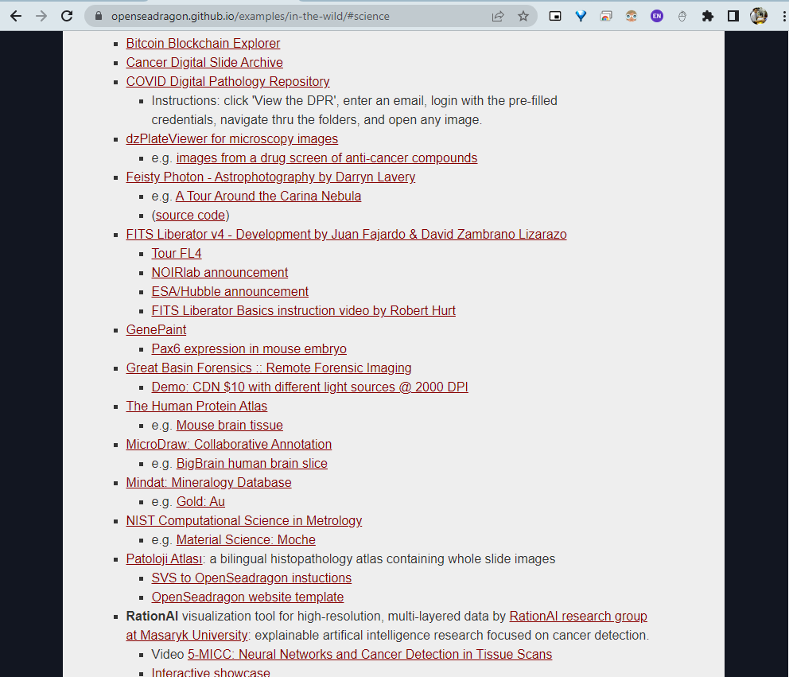
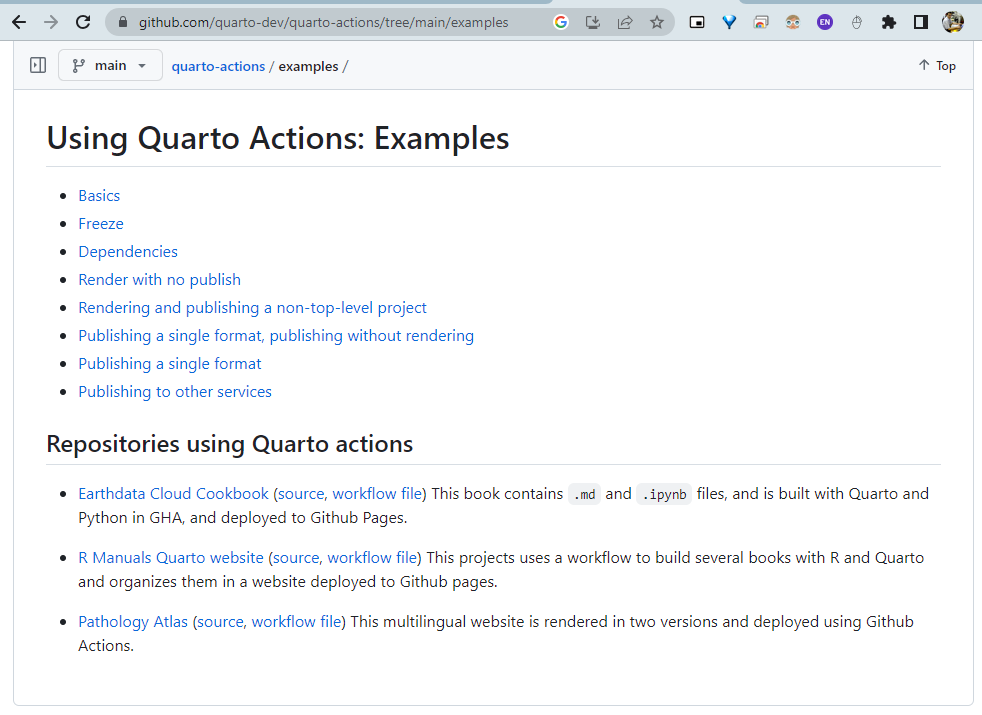

🔬🔬🔬🔬 UNDER CONSTRUCTION 🛠⛔️⚠️🔩


```{r language, echo=FALSE, include=TRUE}
source("./R/language.R")
output_type <- knitr::opts_knit$get("rmarkdown.pandoc.to")
```

```{asis, echo = (language == "TR")}

# Patoloji Atlası Nasıl Geliştiriliyor? {#sec-atlas-gelistirme}

```


```{asis, echo = (language == "TR")}

## Vakaların Seçilmesi {#sec-vaka-secimi}

```


```{asis, echo = (language == "TR")}

### Memorial Patoloji {#sec-memorial-patoloji-vakalari}

```


```{asis, echo = (language == "TR")}

### Diğer Kurumlar ve Özel Koleksiyonlar {#sec-ozel-koleksiyonlar}

```


```{asis, echo = (language == "TR")}

## Dijital Görüntülerin Oluşturulması {#sec-dijital-goruntu-olusturma}

```


```{asis, echo = (language == "TR")}

### Memorial Patoloji {#sec-memorial-patoloji-dijital-vakalari}

```


```{asis, echo = (language == "TR")}

### Diğer Kurumlar {#sec-atlas-icin-gelen-vakalarin-taranmasi}

```


```{asis, echo = (language == "TR")}

### Görüntülerin Taranması {#sec-tarama-islemi}

```


```{asis, echo = (language == "TR")}

### `svs` dosyalarının elde edilmesi {#sec-svs-dosyalarini-elde-etme}

```


```{asis, echo = (language == "TR")}

### Anonimleştirme {#sec-anonimlestirme}

```


```{asis, echo = (language == "TR")}

### görüntülerin `html` haline dönüştürülmesi {#sec-svs-html-donusumu}

```


```{asis, echo = (language == "TR")}

### `openseagradon` {#sec-openseadragon}

```

-   <https://github.com/pathologyatlas/make-html-WSI>


https://github.com/pathologyatlas/make-html-WSI


```{asis, echo = (language == "TR")}

### `vips` kullanarak {#sec-vips}

```


```{asis, echo = (language == "TR")}

### `micaia` programı ile {#sec-micaia}

```


```{asis, echo = (language == "TR")}

## `html` düzenlenmesi {#sec-html-duzenlenmesi}

```


https://github.com/pathologyatlas/template


```{asis, echo = (language == "TR")}

## `html` webe aktarımı {#sec-web-aktarim}

```

-   <https://github.com/pathologyatlas/template>


```{asis, echo = (language == "TR")}

## patoloji atlası web sayfasının hazırlanması {#sec-web-sayfasi}

```

https://github.com/patolojiatlasi/patolojiatlasi.github.io


```{asis, echo = (language == "TR")}

## Quarto ile çok dilli kitap oluşturma {#sec-quarto}

```


```{asis, echo = (language == "TR")}

## epub, word ve pdf formatları {#sec-quarto-formatlari}

```


```{asis, echo = (language == "TR")}

## E-kitap (Apple Books, Google Play Books, LeanPub, GitHub) paylaşımları {#sec-ekitap}

```

<https://leanpub.com/patolojiatlasi/>


```{asis, echo = (language == "TR")}

### GitHub Actions {#sec-github-actions}

```


<https://github.com/patolojiatlasi/patolojiatlasi.github.io/releases/latest/download/HistoPatology-Atlas.epub>


<https://github.com/patolojiatlasi/patolojiatlasi.github.io/releases/latest/download/HistoPathology-Atlas.pdf>


<https://github.com/patolojiatlasi/patolojiatlasi.github.io/releases/latest/download/HistoPatology-Atlas.docx>


<https://github.com/patolojiatlasi/patolojiatlasi.github.io/releases/latest/download/Patoloji-Atlasi.epub>


<https://github.com/patolojiatlasi/patolojiatlasi.github.io/releases/latest/download/Patoloji-Atlasi.pdf>


<https://github.com/patolojiatlasi/patolojiatlasi.github.io/releases/latest/download/Patoloji-Atlasi.docx>


```{asis, echo = (language == "TR")}

## GitHub Durumu {#sec-github-status}

```


[](https://github.com/patolojiatlasi/patolojiatlasi.github.io/actions/workflows/Quarto-Render-Bilingual-Book-Push-Other-Repos-GitLab.yml)


[](https://github.com/patolojiatlasi/patolojiatlasi.github.io/actions/workflows/lecture-notes.yml)


[](https://github.com/patolojiatlasi/patolojiatlasi.github.io/actions/workflows/pages/pages-build-deployment)


[](https://github.com/patolojiatlasi/patolojiatlasi.github.io/actions/workflows/post-wordpress-random-cases.yml)


[](https://github.com/patolojiatlasi/patolojiatlasi.github.io/actions/workflows/post-wordpress-random-cases-EN.yml)


[](https://github.com/patolojiatlasi/patolojiatlasi.github.io/actions/workflows/monthly-release.yml)


[](https://github.com/patolojiatlasi/patolojiatlasi.github.io/actions/workflows/pages/pages-build-deployment)


---


contact: info\@patolojinotlari.com

contact: bilgi\@patolojiatlasi.com

<iframe title="Patoloji Atlası — Leanpub kitap önizlemesi" width="160" height="400" src="https://leanpub.com/patolojiatlasi/embed" frameborder="0" allowtransparency="true">

</iframe>

-   https://github.com/marketplace/actions/quarto-render

-   https://github.com/quarto-dev/quarto-actions


-----

- https://github.com/patolojiatlasi/patolojiatlasi.github.io/releases/latest/download/Patoloji-Atlasi.epub

- https://www.serdarbalci.com/patolojiatlasi/ebook.html


- https://github.com/patolojiatlasi/patolojiatlasi.github.io/releases/latest/download/Patoloji-Atlasi.pdf


- https://github.com/patolojiatlasi/patolojiatlasi.github.io/releases/latest/download/HistoPatology-Atlas.epub

- https://www.serdarbalci.com/histopathologyatlas/ebook.html


-----

- https://itunesconnect.apple.com/

{fig-alt="Patoloji Atlası Apple Books kitap kapağı"}

- https://books.apple.com/us/book/id6456452218


[{fig-alt="Patoloji Atlası’nın OpenSeadragon örnekleri arasındaki görünümü"}](https://openseadragon.github.io/examples/in-the-wild/#science)


[{fig-alt="Patoloji Atlası’nın Quarto örnekleri arasındaki görünümü"}](https://github.com/quarto-dev/quarto-actions/tree/main/examples)





--- 


```{asis, echo = (language == "TR")}

## Patoloji Atlasındaki görüntüleri sunumlarda kullanmak {#sec-powerpoint}

```


Patoloji Atlası'ndaki görüntüleri sunumlarınızda kullanmak isterseniz, [web viewer eklentisini](https://store.office.com/addinsinstallpage.aspx?rs=en-001&assetid=WA104295828) kullanabilirsiniz.  
Örnek dosya için [tıklayın](https://1drv.ms/p/s!Arcuf_-GCY-BjBd9seMcV8yZSR1S?e=HHhoFa).   


<iframe title="Patoloji Atlası görüntülerini PowerPoint sunumlarında kullanma örneği" src="https://1drv.ms/p/s!Arcuf_-GCY-BjBd9seMcV8yZSR1S?e=HHhoFa" width="100%" height="600px" frameborder="0"></iframe>


Patoloji Atlası'ndaki görüntüleri powerpoint sunumlarında nasıl kullanırız?  
Video için [tıklayın](https://youtu.be/3Qw9CO6VdOI).  





